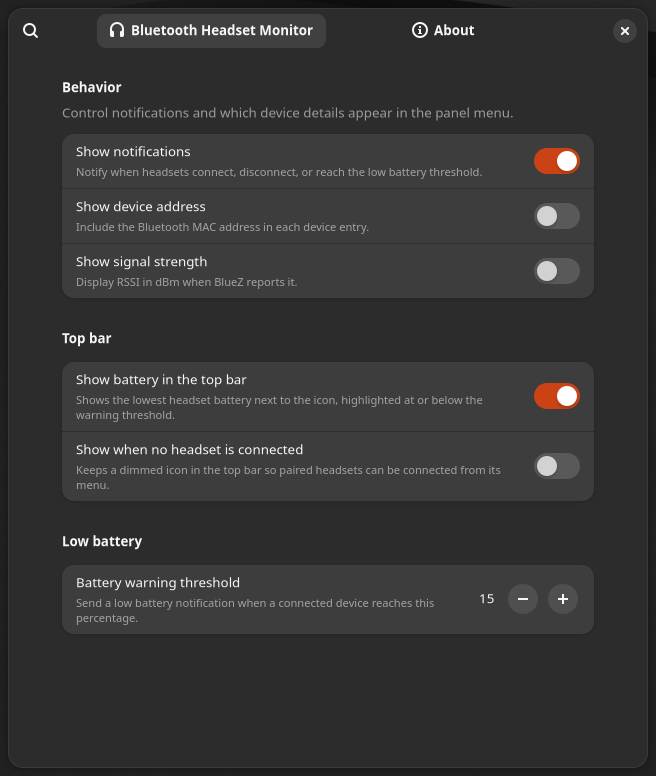

# Bluetooth Headset Monitor

Shows connected Bluetooth headset information in the GNOME top bar: battery
(also next to the icon), advertised audio profiles, and optional Bluetooth
address and signal strength. Connect and disconnect paired headsets from the
menu. Notifications cover connections, disconnections, and low battery. The
indicator is hidden when no compatible device is connected, unless you choose to
keep a dimmed icon for connecting paired headsets.


**Version 1.1.0.** Tested on GNOME 51 (Wayland), in daily use on a desktop and in isolated headless sessions. GNOME 46 and 50 stay listed in metadata but were not separately re-tested for this release. Release steps are tracked in
[issue #2](https://github.com/dileepadev/gnome-bluetooth-headset-monitor/issues/2).

## Screenshots

Low battery next to the icon (at or below the warning threshold):


No headset connected, with **Show when no headset is connected** on (dimmed icon):


Preferences:



Screenshots: dark style, Dash-to-Panel top bar, synthetic data, from an isolated GNOME 51 test session. Devices come from a mock BlueZ service.

## Installation

Download an installable extension ZIP from a [published release](https://github.com/dileepadev/gnome-bluetooth-headset-monitor/releases), then run:

```bash
gnome-extensions install --force /path/to/bluetooth-headset-monitor@dileepa.dev.shell-extension.zip
```

Log out and back in, then enable the extension:

```bash
gnome-extensions enable bluetooth-headset-monitor@dileepa.dev
gnome-extensions prefs bluetooth-headset-monitor@dileepa.dev
```

### From source

Clone the repository, compile the settings schemas, and link the checkout into
your local extensions directory:

```bash
git clone https://github.com/dileepadev/gnome-bluetooth-headset-monitor.git
cd gnome-bluetooth-headset-monitor
make schemas
mkdir -p ~/.local/share/gnome-shell/extensions
ln -s "$PWD" ~/.local/share/gnome-shell/extensions/bluetooth-headset-monitor@dileepa.dev
```

Log out and log back in, then enable the extension:

```bash
gnome-extensions enable bluetooth-headset-monitor@dileepa.dev
```

Because the extension directory is a symlink, `git pull` updates it in place; run
`make schemas` again if the schema changed, then log out and back in. On Wayland,
logging out/in reloads Shell; `Alt + F2`, `r` applies only to supported X11 sessions.

## Behavior and limitations

- Battery and RSSI are shown only when BlueZ provides valid readings. Unknown
  battery is distinct from 0%; RSSI may be unavailable or cached.
- Supported profiles are device capabilities, not the active audio profile or codec.
  Devices must advertise HSP, A2DP Audio Sink, or HFP; AVRCP alone does not qualify.
- “Refresh cached devices” rescans the existing BlueZ cache. It does not start
  discovery or query the headset for a new battery reading.
- Many headsets report their battery a few seconds after connecting. The
  "connected" notification waits up to 8 seconds for it and appears as soon as
  it arrives. If it takes longer, the notification shows "Battery: Unknown" and
  is updated in place when the battery arrives within the next minute.
- Existing connections stay quiet at startup and after BlueZ recovery. A low
  battery can warn at startup. A warning rearms after a known reading above the
  threshold or a confirmed disconnect; missing readings and service restarts do
  not rearm it. Notifications disabled in preferences take effect immediately.
- The panel icon appears only while a compatible headset is connected, unless
  **Show when no headset is connected** is on; then a dimmed icon stays so
  paired headsets can be connected. Its spacing matches AppIndicator icons in
  Ubuntu's default compact mode.
- **Battery in the top bar** (on by default): the lowest battery among connected
  headsets is shown next to the icon, in red and bold at or below the low
  battery threshold. The panel's accessible name lists every headset's level.
- **Connect and disconnect** from the menu: each connected headset has a
  Disconnect item and each paired, disconnected audio device has a Connect
  item. The item shows "Connecting…" while BlueZ works; failures are reported
  with a short reason (Bluetooth off, headset unreachable, attempt in progress).
- Preferences include an **About** page with the version, links, and privacy
  summary.

## Development

Node.js 22.13+ (or a newer supported release), Python 3, GJS, GTK 4, GLib tools,
`dbus-daemon`, and GNU gettext are needed for the full development checks:

```bash
npm ci
npm run check
npm run pack
```

The ZIP is written to `dist/`. npm packages are development tools and are excluded
from the installed extension. Tests use a private mock BlueZ service and an
in-memory settings backend; they do not connect to your real Bluetooth service.
See [docs/DEVELOPMENT.md](docs/DEVELOPMENT.md) for runtime testing and
[po/README.md](po/README.md) for translations.

## Credits

- The headset icon comes from your icon theme (`audio-headset-symbolic`); the extension bundles no icons.
