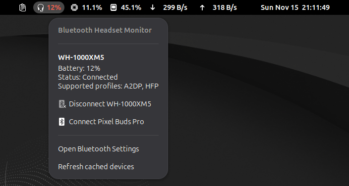

# Bluetooth Headset Monitor

Shows connected Bluetooth headset information in the GNOME top bar.

## Screenshots



## Metadata

```json
{
  "name": "Bluetooth Headset Monitor",
  "description": "Show connected Bluetooth headset information in the GNOME top bar",
  "uuid": "gnome-bluetooth-headset-monitor@dileepa.dev",
  "settings-schema": "org.gnome.shell.extensions.gnome-bluetooth-headset-monitor",
  "url": "https://github.com/dileepadev/gnome-bluetooth-headset-monitor",
  "version": 1,
  "shell-version": ["46", "50", "50.1"]
}
```

## Installation

### Manual Installation

1. **Clone the repository** directly into your local extensions directory:

   ```bash
   git clone https://github.com/dileepadev/gnome-bluetooth-headset-monitor.git \
   ~/.local/share/gnome-shell/extensions/gnome-bluetooth-headset-monitor@dileepa.dev
   ```

2. **Restart GNOME Shell** in order to reload the extensions:
   - **X11**: Press `Alt` + `F2`, type `r`, then press `Enter`.
   - **Wayland**: Log out and log back in.

3. **Enable the extension**:

   ```bash
   gnome-extensions enable gnome-bluetooth-headset-monitor@dileepa.dev
   ```

## Credits

- Icons: <https://gitlab.gnome.org/World/design/icon-library>

> [!NOTE]
> Read [`docs/DEVELOPMENT.md`](./docs/DEVELOPMENT.md) for development guidelines.
